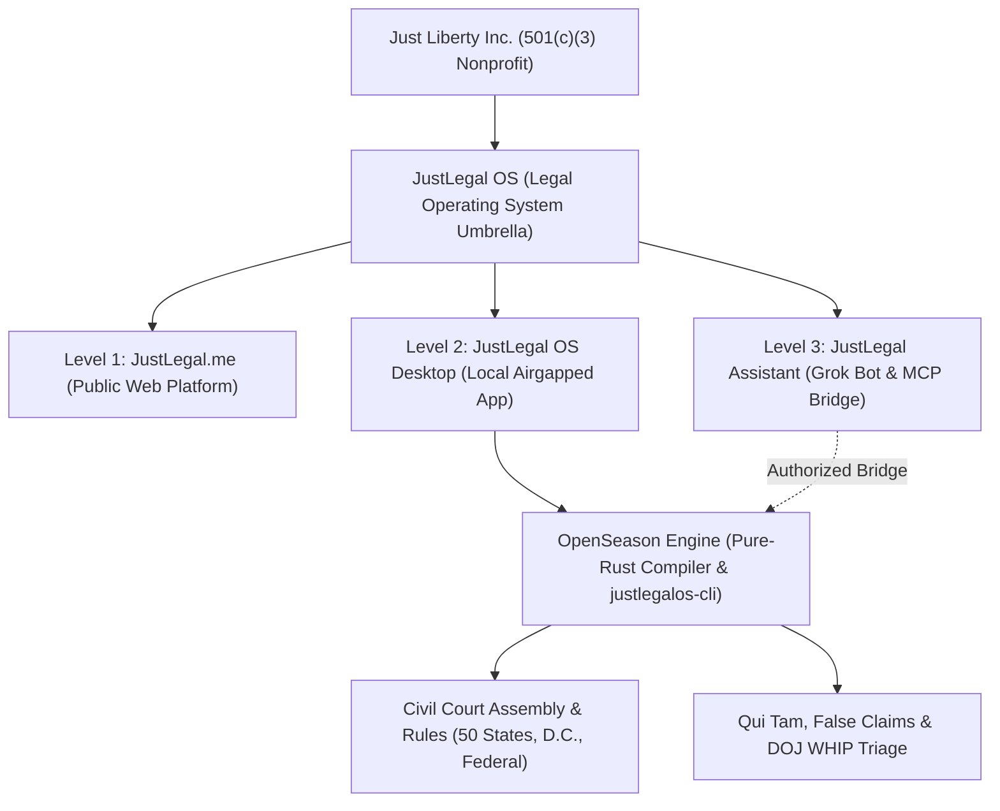
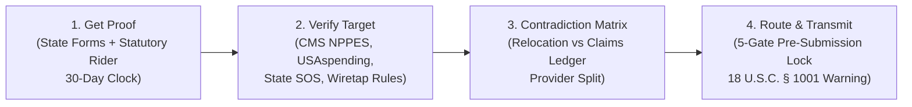

# JustLegal OS
### The Legal Operating System & Offline Court Formatting Engine
Developed by **Just Liberty Incorporated** (Colorado 501(c)(3) Nonprofit Public Benefit Corporation)  
**Official Portals & Socials:** [truejust.org](https://www.truejust.org) • [justlegal.me](https://justlegal.me) • [Fraud Triage](https://justlegal.me/qui-tam) • [LinkedIn](https://www.linkedin.com/company/just-liberty-incorporated/)  
**Direct Contact:** [josh@truejust.org](mailto:josh@truejust.org)

[(3)-Nonprofit%20Public%20Charity-blue?style=for-the-badge)](https://www.truejust.org)
[](https://www.truejust.org)
[](https://www.linkedin.com/company/just-liberty-incorporated/)
[](https://github.com/Just-Liberty-Incorporated/JustLegalOS)
[](#-agent-integration-stdio-mcp-server-justlegalos-cli-mcp)
[](#-technical-specifications--verification-gates)

> **What's in this repo:** This is the public downloads repository. It holds the README, license, changelog, security policy, checksums, the Linux install script and the Grok Bot template ([`MCP_Grok/`](MCP_Grok/)). Installers are attached to [Releases](https://github.com/Just-Liberty-Incorporated/JustLegalOS/releases). **The source code is private** and is not in this repository.

---

## ⚖️ What JustLegal OS Does

**JustLegal OS** is a free, privacy-first legal self-help platform and deterministic procedural operating system designed to dramatically reduce the procedural barriers faced by self-represented litigants, legal aid clinics, and pro bono attorneys.

The central problem JustLegal addresses is the enormous procedural burden placed on people navigating civil courts, administrative agencies, or whistleblower disclosures without full legal representation. Courts strictly enforce caption styles, deadline math, evidentiary separation, certificate of service requirements, and sworn declaration oaths. Missing a single statutory requirement or hedging an affidavit can trigger summary dismissal.

JustLegal solves this by acting as a **deterministic procedural compiler**: it accepts a person's own drafts, verified court records, and physical evidence, checks them against jurisdiction-specific court rules and statutory deadlines, and outputs publication-grade, court-compliant Word (`.docx`) and 28-line numbered PDF packages.

**In one place, JustLegal OS gives you:**
- 🗂️ **Offline case dossiers** for court cases and fraud leads, with status lights that show what is done and what is still missing (never a score or grade).
- 📝 **Court paper assembly:** motions, appeals, extensions, certificates of service, proposed orders, exhibit packets with Bates numbers, and 28-line numbered PDFs.
- 📅 **Deadline math and court-order decoding** that reads your orders and finds candidate deadlines.
- 🏛️ **50-state + D.C. jurisdiction engine** with official `.gov` court doors and rule pinning.
- 📂 **Open records suite** (FOIA, Privacy Act, CORA, OPRA, CPRA and more) with response-clock tracking.
- 🔎 **Fraud and whistleblower triage** with honest 4-state verification receipts, the insider gate, and a 5-gate pre-submission lock. It never files, serves, or submits for you.
- 🔒 **Local airgap and zero telemetry:** sealed matters never sync.
- 🤖 **AI agent bridge:** a bot-safe MCP server with 114 tools and a ready-made Grok Bot template.

### Legal Guardrails & Mission

* **Not a Law Firm:** JustLegal is developed by a 501(c)(3) nonprofit and does not practice law, give legal advice, invent facts, hallucinate citations, or file/serve documents.
* **Pro-Se Empowerment & Professional Referrals:** Every export reminds users to review every line and consult a licensed attorney. JustLegal directly connects users with state bar association referral services, legal aid organizations, and affordable limited-scope representation under ABA Model Rule 5.4.
* **100% Airgapped Confidentiality:** Sealed matters and whistleblower dossiers are permanently isolated from the internet with zero telemetry, client-side encryption (XChaCha20Poly1305 + Argon2id), and hard filesystem locks.

---

## 🚀 Quick Downloads (Choose Your Device)

Download official installers directly from our [Latest GitHub Release (v0.8.0)](https://github.com/Just-Liberty-Incorporated/JustLegalOS/releases/latest):

### 🪟 Windows (Recommended for most desktop users)
[-0078D6?style=for-the-badge&logo=windows&logoColor=white)](https://github.com/Just-Liberty-Incorporated/JustLegalOS/releases/latest/download/JustLegalOS_v0.8.0_Windows_64bit_Setup.exe)
[-5C2D91?style=for-the-badge&logo=windows&logoColor=white)](https://github.com/Just-Liberty-Incorporated/JustLegalOS/releases/latest/download/JustLegalOS_v0.8.0_Windows_64bit_Enterprise.msi)
[-333333?style=for-the-badge&logo=windows&logoColor=white)](https://github.com/Just-Liberty-Incorporated/JustLegalOS/releases/latest/download/JustLegalOS_v0.8.0_Windows_CLI.exe)

- [👉 **Download Windows 64-bit Setup (.exe)** (24.8 MB)](https://github.com/Just-Liberty-Incorporated/JustLegalOS/releases/latest/download/JustLegalOS_v0.8.0_Windows_64bit_Setup.exe): **Main Desktop Application**. Double-click to install on Windows 10 or 11. Built with official Scales of Justice application packaging.
- [👉 **Download Windows Enterprise MSI (.msi)** (34.5 MB)](https://github.com/Just-Liberty-Incorporated/JustLegalOS/releases/latest/download/JustLegalOS_v0.8.0_Windows_64bit_Enterprise.msi): Enterprise / system-wide installer for Windows administrators.
- [👉 **Download Standalone Windows CLI (.exe)** (42.7 MB)](https://github.com/Just-Liberty-Incorporated/JustLegalOS/releases/latest/download/JustLegalOS_v0.8.0_Windows_CLI.exe): Headless Command-Line Interface and 114-tool bot-safe Model Context Protocol (MCP) server for Windows developers and autonomous AI agents.

> **Windows SmartScreen & Integrity Notice:** Because Just Liberty Incorporated was newly chartered in 2026, Microsoft SmartScreen reputation builds progressively over download volume. On first launch, you may see a standard "Unknown Publisher" or "Windows protected your PC" dialog. Click **More info** ➔ **Run anyway**. You can verify every installer against our official [SHA256SUMS.txt](https://github.com/Just-Liberty-Incorporated/JustLegalOS/releases/latest/download/SHA256SUMS.txt) manifest before running.

---

### 🍏 Mac (Apple macOS)
**Coming soon.** macOS `.dmg` installers (Apple Silicon and Intel) are not part of v0.8.0.

---

### 🤖 Linux & Grok Bot AI Agent Container
**Coming soon.** Linux CLI binaries (`x86_64`, `aarch64`, and the Grok Bot container build) are not part of v0.8.0. They will be added to a release when the Linux build is available. Until then the installer below will not find a v0.8.0 Linux binary to install.

**1-Line Terminal / Grok Bot Installer:**
```bash
curl -sSL https://raw.githubusercontent.com/Just-Liberty-Incorporated/JustLegalOS/main/scripts/install-linux.sh | bash
```

Headless / non-interactive container (explicit `-y` consent flag + user-space install, no sudo):
```bash
curl -fsSL https://raw.githubusercontent.com/Just-Liberty-Incorporated/JustLegalOS/main/scripts/install-linux.sh | bash -s -- -y --no-sudo
```

The script detects CPU architecture (`x86_64` or `aarch64`), verifies the SHA-256 checksum against the release manifest, installs `justlegalos-cli` to `~/.local/bin`, and runs `justlegalos-cli --json doctor`.

> **Linux System Requirement:** Requires standard 64-bit Linux with GLIBC 2.35 or newer (e.g., Ubuntu 22.04 LTS+, Debian 12+, Fedora 36+, or modern bot container base images).

---

### 🔒 Cryptographic Verification
- [👉 **SHA256SUMS.txt (Official Manifest)**](https://github.com/Just-Liberty-Incorporated/JustLegalOS/releases/latest/download/SHA256SUMS.txt): SHA-256 hashes for every file in the release.

```powershell
# Windows PowerShell: compare the output with the line in SHA256SUMS.txt
Get-FileHash .\JustLegalOS_v0.8.0_Windows_64bit_Setup.exe -Algorithm SHA256
```

---

## 🧭 The 3-Part JustLegal Ecosystem



| Component | Platform / Tech | Purpose & Core Capabilities |
|---|---|---|
| **[JustLegal.me](https://justlegal.me)** | React, TypeScript, Vite, Firebase | **Public Legal Resource Hub:** 22,936 court forms, 16,023 mirrored PDFs, in-browser PDF tools, legal aid directories, fee waiver guides, and optional authenticated case sync. |
| **JustLegal OS Desktop** | Tauri v2, Svelte 5, Rust (`open_season_lib`) | **Local-First Legal Operating System:** Offline case dossiers, court cases and fraud leads tabs, status lights, Bates stamping, court record reconstruction, ADA Title II petitions, background cloud sync with pause, and a zero-telemetry vault. |
| **JustLegal Assistant / Grok Bot** | Public recipe (v9), 15 modular skills, system prompt, CLI bridge | **Conversational Guide & Agent Operator:** Unified conversational triage for civil procedure and fraud intake, fail-closed verification receipts, and built-in Linux workspace support. Template in [`MCP_Grok/`](MCP_Grok/). |

---

<details>
<summary><strong>🖥️ The Desktop App (GUI): screens and tools</strong></summary>

The desktop app (`JustLegal OS`, Tauri v2 + Svelte 5) has these screens in v0.8.0:

| Screen | What it does |
|---|---|
| **Workspace (home)** | Your matters in two tabs: **Court cases** and **Fraud leads**. Each row has status lights (gray / amber / green only; hover shows the source and date; clicking a light opens the related step). Shortcuts to forms and the agent. |
| **New matter** | Guided creation of a court case or a fraud lead. The **New fraud lead wizard** asks Track A/B, program state, residency state and target name. |
| **Case page** | "Your work at a glance", recent activity, **Matter tools**, and **Storage & privacy**. Motion docket, party editor, court-order review card, pre-flight audit, procedural graph, next-up card and jurisdiction readiness strip. |
| **Fraud lead page** | The 4-step **Records ➔ Verify ➔ Compare ➔ Route** progress bar for a fraud lead. |
| **Fraud leads and sealed vault** | Confidential matters that never sync. |
| **What do I need to file?** | Plain-language finder. Legal information, not advice. |
| **Forms & templates** | Suggested court forms and documents for your matter. |
| **Draft formatter** | Turn your own draft into a court-formatted document and PDF. |
| **Forms packs** | Bundled rule packs (teaching + deadlines), available form packs, and packs installed on this computer. |
| **AI** | Agent charter and the **Install JustLegal Assistant in Grok Bot** button ([x.ai/bot/w6UVAg2EoGUZgZRE90SL9](https://x.ai/bot/w6UVAg2EoGUZgZRE90SL9)). |

**Built-in tools and dialogs:** Intake Wizard (one question at a time), ADA accommodation request, accountability routes, court record retrieval, consultation dossier, PDF tools (merge, split, rotate, redact), Signature Studio, Certificate of Service, Cloud Sync (live progress, Pause / Resume, Cancel), Help menu (Open log folder / Copy diagnostics), Legal terms, and a Spanish language option (unofficial translation; court forms and required notices stay in their official language).

</details>

<details>
<summary><strong>📚 National Court Forms Registry & Public Tools (justlegal.me)</strong></summary>

The public **[JustLegal.me](https://justlegal.me)** platform hosts one of the largest structured legal self-help catalogs in the United States:

* **22,936 Indexed Court Forms:** Covering all 50 states, Washington D.C., and all 94 federal judicial districts.
* **16,023 Mirrored Official PDFs:** Stored with retrieval metadata, official source links, and SHA-256 integrity verification hashes.
* **In-Browser Legal Utilities:**
  - **PDF Studio & Zero-Leakage PII Redactor:** Merge, split, rotate, and scrub SSNs/DOBs client-side.
  - **Bates Stamper:** Sequentially number exhibits with custom prefix formatting (e.g., `SAMPLE-000001`).
  - **Fee Waiver Generator:** Guided completion of in forma pauperis financial qualification forms.
  - **Courtroom Oral Argument Cards:** Structured rehearsal notes and hearing outline cards.
  - **State Bar & Legal Aid Router:** Direct referral to State Bar certified lawyer referral services and Legal Services Corporation (LSC) providers.

</details>

<details>
<summary><strong>🧰 Production Subsystems & 114 Deterministic MCP Tools (Pure-Rust Engine & CLI)</strong></summary>

The deterministic Rust core and native command-line interface (**`justlegalos-cli`**, shipped for Windows as `JustLegalOS_v0.8.0_Windows_CLI.exe`) expose **42 top-level CLI commands** and an MCP server with **114 tools in the default bot-safe mode (118 with `--unrestricted`)** that both human operators and AI agents can run with reproducible results:

```
┌────────────────────────────────────────────────────────────────────────┐
│               JUSTLEGAL OS SUB-SYSTEM ARCHITECTURE MATRIX              │
├───────────────────────────────────┬────────────────────────────────────┤
│ 1. 360° Case Context Bundle       │ 10. Bates Packets & Court Exports  │
│    • `case context` (1-call JSON) │    • `export exhibit-packet`       │
│    • Profile, events, gaps, rules │    • Typst 28-line numbered PDFs   │
├───────────────────────────────────┼────────────────────────────────────┤
│ 2. Guided Intake & PDF Auto-Scan  │ 11. Zero-Leakage Offline PDF Studio│
│    • `intake scan` & `answer`     │    • `pdf merge|split|rotate|redact`│
│    • Offline PDF text extraction  │    • Byte-level PII scrubbing      │
├───────────────────────────────────┼────────────────────────────────────┤
│ 3. Predictive Next Steps & Venue  │ 12. Qui Tam Fraud Triage           │
│    • `case next-steps`            │    • `qui-tam verify|audit-9b|pack`│
│    • NJ Pause vs. Fed Reset toll  │    • Dual-track routing & card     │
├───────────────────────────────────┼────────────────────────────────────┤
│ 4. 30-Day Extension Safeguard     │ 13. Sovereign Immunity Audit       │
│    • `motion extension`           │    • `sovereign-immunity`          │
│    • Procedural lifeline & email  │    • Ex parte Young, ADA § 504     │
├───────────────────────────────────┼────────────────────────────────────┤
│ 5. Court Record Reconstruction    │ 14. Vernacular-to-Doctrine Engine  │
│    • `record inventory|reconcile` │    • `claim translate`             │
│    • Docket text parser & Form NJ │    • Mountain of proof (X + Y + Z) │
├───────────────────────────────────┼────────────────────────────────────┤
│ 6. Judicial Findings Audit        │ 15. Pro Se Multi-Plaintiff Joinder │
│    • `review record`              │    • `collective-action`           │
│    • Cross-examines orders vs doc │    • FRCP Rule 20(a)(1) force mult.│
├───────────────────────────────────┼────────────────────────────────────┤
│ 7. Accountability & Ethics Packets│ 16. Statutory Open Records Suite   │
│    • `accountability routes|packet│    • `records find|draft|track`    │
│    • Judicial & attorney ethics   │    • CORA, FOIA, 501(c)(3) waivers │
├───────────────────────────────────┼────────────────────────────────────┤
│ 8. ADA Title II Petition Engine   │ 17. 14-Pathway Accountability Map  │
│    • `ada petition`               │    • `accountability map`          │
│    • CART, remote hearing, breaks │    • Systemic & contractor routes  │
├───────────────────────────────────┼────────────────────────────────────┤
│ 9. Proof of Service & Orders      │ 18. Receiver-Ready Formatter       │
│    • `service cert` & `order`     │    • `export receiver`             │
│    • Judge-ready Proposed Orders  │    • DOL-OIG, CO-OSA, GAO FraudNet │
├───────────────────────────────────┼────────────────────────────────────┤
│ 19. 50-State Jurisdiction Engine  │ 20. DOJ WHIP Verification & Gaps   │
│    • `jurisdiction status|lock`   │    • `whip receipt|gaps|route-hold`│
│    • 5-slot traffic light receipt │    • `packet lint` pre-export check│
├───────────────────────────────────┼────────────────────────────────────┤
│ 21. Unified Grok Bot Workspace    │ 22. Investigation Traps & Consent  │
│    • `init-workspace`             │    • `check state-traps`           │
│    • Embeds skills, bin, cases    │    • 1-party vs 2-party wiretap laws│
├───────────────────────────────────┼────────────────────────────────────┤
│ 23. v0.8 Duplicate-Case Migration │ 24. Diagnostics & Daily Logs       │
│    • `migrate v08` (preview first)│    • `doctor --logs`               │
│    • Backup, hash-skip, no guess  │    • Airgap & workspace checks     │
└───────────────────────────────────┴────────────────────────────────────┘
```

**All 42 CLI commands in v0.8.0** (`justlegalos-cli --help`):

| Command | Purpose |
|---|---|
| `case` | create, validate, seal, seed, import-folder, context, next-steps, escalate, bootstrap, profile |
| `draft` | Import and fill your own draft text |
| `evidence` | Add, index and link evidence |
| `check` | fact, authority, deadline, signoff, all, preflight, transcripts, venue, state-traps |
| `export` | notice-of-appeal, pleading, court-md, packet, exhibit-packet, ics, consultation-dossier, receiver |
| `packs` | Install, verify and list rule / form packs |
| `guide` | What do I need to file? Plain-language finder. Legal information, not advice |
| `gaps` | Record what is still missing |
| `docs` | Agent playbook, field help, JustLegal resource links |
| `mcp` | MCP stdio server (defaults to bot-safe sandbox mode) |
| `agent` | Agent contract: tool list, MCP launch, starter prompt (`manifest`, `capabilities`) |
| `capabilities` | Agent capabilities manifest (JSON) |
| `sync` / `cloud` | JustLegal Cloud sync and authentication |
| `form` | Official court form AcroForm inspection and auto-filling |
| `motion` | list, create, export, extension, extension-suggest |
| `service` | Certificate of Service (`cert`) and Proposed Form of Order (`order`) |
| `pdf` | merge, split, rotate, redact, extract-text |
| `sign` | Stamp a court-compliant electronic signature block onto a PDF |
| `intake` | status, answer, scan (guided intake and offline PDF scanner) |
| `portfolio` | Multi-state portfolio deadline radar and global filer profile |
| `record` | inventory, reconcile, missing, request-form, plan-retrieval |
| `review` | record, stress-test |
| `accountability` | routes, resources, packet, map |
| `ada` | Title II ADA court accommodation petition |
| `order` | Decode court orders and notices (signer, operative clauses, candidate deadlines) |
| `timeline` | Audit mailing postmarks vs clerk receipt timestamps |
| `court` | Court access directory (clerk hours, e-filing portals, docket search, fee schedules) |
| `workflow` | Agent workflow coordinator: plan, advance, resume |
| `qui-tam` | verify-entity, audit-9b, ingest-observation, records-pack, export-disclosure, format-portal, format-inquiry |
| `doctor` | System health, workspace, packs, logs and airgap diagnostic |
| `migrate` | One-time v0.8 duplicate-folder merge from a local plan file (preview by default) |
| `version` | Engine version |
| `records` | find, draft, track, followup, audit-provider, org |
| `claim` | translate (vernacular-to-doctrine) |
| `sovereign-immunity` | Sovereign immunity barriers and bypass pathways |
| `collective-action` | Rule 20 joinder, Rule 23 class pitch binder, or APA rulemaking petition |
| `init-workspace` | Initialize a shared agent workspace with embedded skills, templates, bin and cases |
| `whip` | receipt, gaps, route-hold, conflict-roster, compare-routes, prepare, quick-pack, audit, contradiction, split-providers, unmask, approve, submit |
| `jurisdiction` | status, lock-rule, add, doors, find |
| `packet` | lint |
| `states` | audit (50-state dataset integrity and provenance) |
| `test-fixtures` | Regression fixtures |
| `setup-deps` | Install and verify poppler, pdftotext, tesseract |

</details>

<details>
<summary><strong>⌨️ CLI Command Family Quick-Reference (examples)</strong></summary>

All commands output structured, envelope-wrapped JSON (`{ ok, never_files, never_serves, data, issues }`). All names below are obviously fake samples.

```bash
# 1. Inspect complete case context in a single call
justlegalos-cli --json case context ./my-case

# 2. Extract offline text and candidate dates from court PDFs
justlegalos-cli --json intake scan ./my-case

# 3. Compute predictive next procedural steps and deadline tolling
justlegalos-cli --json case next-steps ./my-case
justlegalos-cli --json check venue ./my-case

# 4. Court Record Reconstruction & Transcript Reconciliation
justlegalos-cli --json record inventory ./my-case
justlegalos-cli --json record reconcile ./my-case --docket "02/15/2026 ORDER DISMISSING COMPLAINT..."
justlegalos-cli --json record missing ./my-case
justlegalos-cli --json record request-form ./my-case --state NJ

# 5. Judicial Findings Audit & Ethical Accountability
justlegalos-cli --json review record ./my-case
justlegalos-cli --json accountability routes ./my-case
justlegalos-cli --json accountability packet ./my-case --issue "finding-3-unsupported"

# 6. ADA Title II Accommodation Petition Generator
justlegalos-cli --json ada petition ./my-case --name "Jordan Example" --accommodations "remote,reading_time"

# 7. False Claims Act / Qui Tam Fraud Triage
justlegalos-cli --json qui-tam verify-entity --name "Jordan Health LLC" --state MN
justlegalos-cli --json qui-tam audit-9b ./my-case
justlegalos-cli --json qui-tam ingest-observation ./my-case --file "photo.jpg" --notes "Doors locked at 2 PM on Tuesday"
justlegalos-cli --json qui-tam records-pack ./my-case --state MN
justlegalos-cli --json qui-tam export-disclosure ./my-case
justlegalos-cli --json qui-tam format-inquiry ./my-case
justlegalos-cli --json qui-tam format-portal ./my-case --agency HHS

# 8. DOJ Whistleblower Incentive Program (WHIP) & Fail-Closed Audits
justlegalos-cli --json whip receipt ./my-case
justlegalos-cli --json whip gaps ./my-case
justlegalos-cli --json whip route-hold ./my-case
justlegalos-cli --json whip conflict-roster ./my-case
justlegalos-cli --json whip compare-routes ./my-case
justlegalos-cli --json whip prepare ./my-case
justlegalos-cli --json whip approve ./my-case --decision GO --reviewer "Jordan Example"   # Gate 5: a person must run this; scripted approval is refused
justlegalos-cli --json whip submit ./my-case --confirmation "DOJ-WHIP-2026-998877"      # records YOUR confirmation number; the tool never submits
justlegalos-cli --json whip quick-pack --name "Target Clinic LLC" --file "photo.jpg" --notes "Doors locked at 2 PM on Tuesday"
justlegalos-cli --json packet lint ./my-case

# 9. Vernacular-to-Doctrine Translator & Mountain-of-Proof Blueprint (P17)
justlegalos-cli --json claim translate --vernacular "The director took kickbacks by letting the vendor break the benefits computer"

# 10. Sovereign Immunity Audit & Valid Bypass Pathways (P18)
justlegalos-cli --json sovereign-immunity --state CO --target gov-agency --claim "FCA qui tam" --claim "ADA Title II disability" --claim "Ex parte Young due process"

# 11. Collective Action Builder (Rule 20 Permissive Joinder / Pro Se Force Multiplier) (P19)
justlegalos-cli --json collective-action --mode rule20-joinder --title "Sample Benefits Hold Challenge" --defendant "Sample State Agency & Sample Vendor"

# 12. Statutory Open Records Pre-Filing Discovery Suite (CORA, FOIA, NC DES, § 603.5(c)) (P2–P8)
justlegalos-cli --json records find --jurisdiction CO --type contract
justlegalos-cli --json records draft ./my-case --jurisdiction CO --type contract --fee-waiver
justlegalos-cli --json records track ./my-case --id CORA-01 --agency "Sample Records Custodian" --sent 2026-03-01 --days 3
justlegalos-cli --json records followup ./my-case --id CORA-01 --agency "Sample Records Custodian" --kind late
justlegalos-cli --json records org

# 13. 14-Pathway Systematic Accountability Map (P1)
justlegalos-cli --json accountability map ./my-case --state CO --program UI --target-type state-agency

# 14. 50-State Jurisdiction Verification & Primary-Source Rule Pinning
justlegalos-cli --json jurisdiction status ./my-case
justlegalos-cli --json jurisdiction find ./my-case
justlegalos-cli --json jurisdiction doors ./my-case
justlegalos-cli --json jurisdiction lock-rule ./my-case --slot local_court_rules --cite "Sample County Standing Order 01" --url "https://www.njcourts.gov/"
justlegalos-cli --json check state-traps --state CA

# 15. Shared Agent Workspace Initialization
justlegalos-cli --json init-workspace --root /workspace

# 16. Receiver-Ready Formatter (P16)
justlegalos-cli --json export receiver ./my-case --to dol-oig

# 17. Document Production, Bates Stamping & Redaction
justlegalos-cli --json export exhibit-packet ./my-case --prefix "SAMPLE-"
justlegalos-cli --json export court-md ./my-case
justlegalos-cli --json pdf redact --input "sensitive.pdf" --patterns "SSN,DOB"

# 18. New in v0.8: duplicate-case migration and diagnostics
justlegalos-cli --json migrate v08            # preview (default)
justlegalos-cli --json migrate v08 --apply    # backup first, then merge
justlegalos-cli --json doctor --logs
```

On Windows, run the downloaded CLI as `.\JustLegalOS_v0.8.0_Windows_CLI.exe --json ...` (or rename it to `justlegalos-cli.exe`).

</details>

<details>
<summary><strong>🏛️ Expanded Whistleblower, Fraud & Administrative Accountability Architecture</strong></summary>

While version 0.1.0 was forged to triage **Street-Level Storefront Fraud** (ghost clinics, dark windows during posted hours, and inactive NPIs billing Medicare/Medicaid), JustLegal OS now encompasses the complete spectrum of **Systemic Institutional Mismanagement & Government Contractor Fraud**.

When ordinary citizens experience systemic fallout (such as automated unemployment integrity freezes, non-responsive state agencies, and large contractor IT failures), traditional advice often defaults to defeatist brush-offs like *"go vote,"* *"call 211,"* or *"post on social media."* JustLegal OS replaces platitudes with **deterministic systems-engineering and statutory bypass routing**:

```
┌───────────────────────────────────────────────────────────────────────────────────┐
│              TWO HALVES OF THE FRAUD & ACCOUNTABILITY UNIVERSE                    │
├─────────────────────────────────────────┬─────────────────────────────────────────┤
│ 1. STREET-LEVEL STOREFRONT FRAUD        │ 2. SYSTEMIC INSTITUTIONAL & CONTRACTOR  │
├─────────────────────────────────────────┼─────────────────────────────────────────┤
│ • "Ghost" clinics & adult daycares      │ • Agency automated holds & benefit freezes│
│ • Photo ingestion & EXIF GPS stripping  │ • Prime tech vendor non-compliance      │
│ • Keyless CMS NPPES v2.1 NPI auditing   │ • Sovereign Immunity audit (Stevens bar)│
│ • Direct False Claims Act (Track A/B)   │ • Ex parte Young & ADA Title II bypass  │
│ • In camera federal seal (§ 3730(b)(2)) │ • Pre-filing Open Records Suite (CORA)  │
│ • Character-trimmed HHS-OIG portal text │ • FRCP Rule 20(a)(1) Pro Se Joinder     │
└─────────────────────────────────────────┴─────────────────────────────────────────┘
```

### 1. Navigating Sovereign Immunity: The *Stevens* Boundary & Valid Bypass Pathways
Under *Vermont Agency of Natural Resources v. United States ex rel. Stevens*, 529 U.S. 765 (2000), states and state agencies are immune from federal False Claims Act qui tam lawsuits. Naming a state department as a qui tam defendant triggers immediate dismissal. JustLegal OS evaluates **5 valid statutory bypass pathways**:
* **Ex parte Young (209 U.S. 123):** Sue state executive directors in their official capacity for prospective declaratory and injunctive relief to halt unlawful automated holds.
* **ADA Title II Abrogation (*United States v. Georgia*, 546 U.S. 151 (2006)):** Congress validly abrogated state sovereign immunity for disability access deprivations that independently implicate Fourteenth Amendment Due Process. **Money damages and injunctive relief are viable directly against the agency.**
* **Rehabilitation Act § 504 Spending Clause Waiver (29 U.S.C. § 794; 42 U.S.C. § 2000d-7):** Acceptance of federal grants (e.g. DOL Unemployment Assistance Listing Number 17.225) waives state Eleventh Amendment immunity in federal court.
* **Private Prime Contractor Liability (31 U.S.C. § 3729(b)(2)(A)(ii)):** Private IT, claims, and management vendors possess no sovereign immunity and face treble damages under the False Claims Act.
* **County & Municipal Liability (*Monell*, 436 U.S. 658):** Counties, cities, and local clerk/sheriff departments have no Eleventh Amendment protection.

### 2. FRCP Rule 20(a)(1) Permissive Joinder: The Pro Se Force Multiplier
Under *Oxendine v. Williams*, 509 F.2d 1405 (4th Cir. 1975), self-represented litigants cannot represent a class under Rule 23. JustLegal OS provides the lawful alternative: **Federal Rule of Civil Procedure 20(a)(1) Permissive Joinder**. Between 2 and 25 affected individuals sue jointly on a single docket, share one court filing fee, sign on their own behalf, and cure mootness (preventing the agency from picking off the lead filer to dismiss the lawsuit).

### 3. Pre-Filing Statutory Open Records Suite (CORA, FOIA & § 603.5)
Lawful evidence requires the underlying prime contracts, vendor amendments, and SOC 1 Type II audit logs. The engine identifies governing sunshine regimes (Colorado CORA C.R.S. § 24-72-201, Federal FOIA 5 U.S.C. § 552, Privacy Act 5 U.S.C. § 552a, NC DES, 20 C.F.R. § 603.5), drafts formal letters requesting 501(c)(3) public interest fee waivers under Just Liberty Inc. (EIN 93-3704483), and tracks response windows using calendar math that skips weekends and federal holidays.

### 4. Vernacular-to-Doctrine Engine & The Mountain-of-Proof Blueprint
Pro se complaints often get dismissed because citizens express grievances in everyday vernacular ("they committed treason", "they took kickbacks", "they made everyone sick", "amend the constitution"). The `claim translate` engine converts colloquial complaints into exact statutory causes of action (18 U.S.C. §§ 666/1346, 42 U.S.C. § 1983, Civil RICO 18 U.S.C. § 1964(c), Anti-Kickback Act, APA § 553(e)) and provides the actionable blueprint:

**Actionable Claim = Element X + Element Y + Mountain of Verified Evidence Z**

</details>

<details>
<summary><strong>🕵️ Two-Tier Whistleblower Economy: DOJ WHIP & Sealed Qui Tam</strong></summary>

Built for triage under the White House / DOJ **Fraud Whistleblower Incentive Program (WHIP on [america.gov/fraud](https://www.america.gov/fraud))**, the **DOJ WHIP Guidelines** under 28 U.S.C. § 530C(b)(1)(L), and the **False Claims Act** (*31 U.S.C. §§ 3729–3733*). JustLegal OS is an independent nonprofit tool; it is not a government program and is not endorsed by any agency.

Just Liberty Incorporated provides a **free, public-interest pre-seal verification pipeline** that turns citizen observations and insider disclosures into hashed, unembellished 4-state verification receipts (`VERIFIED`, `USER_STATED`, `MISSING`, `LOOKUP_FAILED`):

```
======================================================================
JUSTLEGAL OPEN-RECORD VERIFICATION RECEIPT
Generated via JustLegal OS / Just Liberty Inc. (501c3) Engine
======================================================================
• TARGET ENTITY: [Exact Legal Name / Registered Business Name]
• ENUMERATION DATA: NPI-1 / NPI-2: [10-Digit Verified] | UEI: [12-Char Verified]
• REGISTERED TAXONOMY: [Code + Description] vs. Observed Physical Status
• FEDERAL AWARDS NEXUS: [USAspending / CMS / State Lookups]
• VERIFICATION STATUS: 4-State Receipt (VERIFIED, USER_STATED, MISSING, LOOKUP_FAILED)
• EVIDENCE INTEGRITY: SHA-256 Digest (64-Char Hex) / EXIF GPS Stripped
• CITATION STANDARDS: 31 U.S.C. § 3730 / 28 U.S.C. § 530C(b)(1)(L)
• VERIFY TOOLS: https://justlegal.me/qui-tam
======================================================================
```

### The Dual-Track / Three-Track Whistleblower Engine
To protect statutory whistleblower rights, the engine routes dossiers through a strict evaluation:
1. **Tier 1: Fast-Track Citizen Bounty (`WHIP` via `america.gov/fraud`):** Administrative bounty track for street-level observations. Generates character-limited (≤1,950 character) submissions, scrubs personal identifying information, strips EXIF GPS coordinates, and compiles a tamper-evident photographic PDF packet with full 64-character SHA-256 digests (`WHIP_Evidence_Packet.pdf`).
2. **Tier 2: Sealed Qui Tam Lawsuit (31 U.S.C. §§ 3729–3733; Statutory Relator Share under 31 U.S.C. § 3730(d)):** For contractor and institutional schemes (e.g., state IT contracts, regional healthcare billing). Evaluates statutory intervention windows without premature public disclosure, protecting mandatory *in camera* seal rules (31 U.S.C. § 3730(b)(2)). Generates privileged inquiry packets under ABA Model Rule 1.18 for private False Claims Act attorneys, who typically evaluate matters on contingency.
3. **Track B (Citizen Watchdog / Direct Agency Track):** For localized storefront abuse or administrative tips. Formats character-limited text blocks for HHS-OIG, DOL-OIG, DOJ Civil Fraud, and State AG MFCU web portals.
4. **Track C: Systemic Oversight & Civil Rights (Ex parte Young / Rule 20 Joinder):** For claims targeting immune state agencies (*Stevens* bar), automated benefit freezes, or administrative non-compliance.
5. **⚠️ Insider Gatekeeper Fork (`whip route-hold`):** Non-public insider records held by the relator trigger an automatic lock blocking public portal export (`portal_export_blocked = true`). The system instead exports a factual index and a conflict-check roster (names and identifiers only, zero narrative) for retained counsel.
6. **Fail-Closed 4-State Verification Receipt (`whip receipt` & `whip gaps`):** Replaces artificial score gauges with an unembellished 4-state table. Exits with code 1 on blocking gaps before allowing export.
7. **Pre-Export Audit Linter (`packet lint`):** Scans all generated export files and fails closed if any forbidden vanity phrases, unsworn certifications, or invented legal conclusions are detected.
8. **Factual Calling Card:** Injects a clean, factual header with the public verification URL (`https://justlegal.me/qui-tam`) without asserting unverified legal conclusions.

### The 3-Tier Entity Verification Architecture
1. **Tier 1 (CMS NPPES Provider Registry):** Direct federal NPI-1 and NPI-2 enumeration via the CMS NPPES v2.1 API. Confirms active registration, primary practice location, authorized officials, and taxonomy codes.
2. **Tier 2 (USAspending Direct Federal Awards):** Direct federal procurement contracts, prime grants, and direct loans from HHS, VA, and DoD under Federal Award ID / UEI records.
3. **Tier 3 (State-Administered Medicaid Claims Guidance):** State Medicaid expenditures flow through state health agencies rather than direct USAspending awards. The absence of direct awards on USAspending does not indicate zero Medicaid billing; the engine flags this distinction and provides tailored state open records (FOIA/CORA) guidance.

</details>

<details>
<summary><strong>🔁 The Master 4-Step Funnel Across All Surfaces</strong></summary>

JustLegal OS, the Desktop GUI, the CLI, and Grok Bot guide citizens and investigators through a deterministic 4-step sequence powered by a single normalized dataset (in the desktop app: **Records ➔ Verify ➔ Compare ➔ Route**):



1. **Step 1: Get Your Proof (First-Party Statutory Discovery & 30-Day Countdown):**
   - Direct statutory requests for Medicaid claims histories (**45 C.F.R. § 164.524**), Unemployment claim files (**20 C.F.R. § 603.5(c)**), SNAP casefiles (**7 C.F.R. § 273.15(p)**), and state vendor contracts (**CORA/OPRA/FOIA**).
   - Solves the mailroom vs. backend database dilemma with the **"Official State Form + Itemized Statutory Rider"** pattern.
   - Enforces the **Stage 1 vs. Stage 4 Firewall**: personal records requests are strictly quarantined from fraud prosecution hotlines.
2. **Step 2: Verify Your Target (Objective Cross-Registry Corroboration):**
   - Verifies rendering and billing entities against CMS NPPES v2.1 (10-digit NPIs), USAspending federal obligations, SAM.gov, state corporate registries, and state licensing boards.
   - Audits state-specific recording rules (one-party vs. all-party wiretap laws) before evidentiary audio is logged.
3. **Step 3: Build the Contradiction Matrix (Relocation vs. Claims Auditing):**
   - Ingests claims ledgers (`.pdf`, `.csv`, `.tsv`, `.json`) and cross-references transaction dates against documented absence/relocation dates (`whip contradiction`).
   - Partitions multi-provider ledgers into discrete dossiers (`whip split-providers`) pursuant to the **DOJ WHIP Guidelines (28 U.S.C. § 530C(b)(1)(L))** to prevent multi-defendant dismissals.
4. **Step 4: Route & Transmit (The 5-Gate Pre-Submission Protocol):**
   - Evaluates the Insider vs. Outsider fork: non-public insider records route exclusively to sealed relator counsel under ABA Model Rule 1.18.
   - External disclosures for `america.gov/fraud` or agency OIGs proceed only after all 5 Pre-Submission Gates pass and the human explicitly authorizes transmission.

</details>

<details>
<summary><strong>🚦 The 5-Gate Pre-Submission Lock (Zero Autonomous Filing)</strong></summary>

To prevent premature submissions, safeguard statutory standing, and protect against automated overreach, JustLegal OS and Grok Bot enforce a mandatory 5-gate protocol:

| Gate | Verification Check | Failure Action |
|---|---|---|
| **Gate 1: Verification Receipt** | Target credentials verified on CMS NPPES & USAspending; data partitioned into `VERIFIED` vs. `USER_STATED`. | Blocks submission until entity credentials resolve. |
| **Gate 2: Lawful Evidence & Privacy** | Audio evidence complies with state wiretap laws; third-party PII scrubbed; photographic EXIF GPS tags stripped. | Blocks submission until evidence is legally grounded. |
| **Gate 3: Insider & Route Clearance** | If user holds non-public insider records, public web portal export is locked (`portal_export_blocked = true`). | Routes user to zero-narrative conflict roster for sealed counsel. |
| **Gate 4: Pre-Export Packet Linter** | Narrative ≤ 1,950 characters; 64-char SHA-256 hashes verified; 0 banned vanity or inflammatory phrases. | Fails closed (exit code 1) until text is compliant. |
| **Gate 5: Explicit Human Review ("GO")** | Renders exact form fields in chat/browser; displays statutory warning; awaits the person's own affirmative confirmation (`whip approve`). Scripted or agent approval is refused. | Halts execution. Never auto-submits without explicit consent. |

</details>

<details>
<summary><strong>🗺️ 50-State Legal Discovery & The 6 Operational Pillars</strong></summary>

State public records and beneficiary access rules vary widely. JustLegal OS compiles these rules into **`data/states/`** across 51 jurisdictions (50 States + D.C.), with embedded court doors (52-jurisdiction court gateway data, municipal court portals, and official-domain verification for local rules), under 6 operational pillars:

1. **Anti-Rejection Form Rules (Stage 1):** Provides the official mandatory state agency form number and URL, while generating the **"Cover Demand + Itemized Statutory Rider"** to legally compel backend MMIS codes, 10-digit NPIs, and monthly MCO capitation ledgers.
2. **Public Registry Lookup Engines (Stage 2):** Direct deep-search URLs for state spending checkbooks, corporate business registries, day care licensing portals, and health facility verification.
3. **State Litigation Traps & Wiretap Laws:** State-specific response deadlines, exhaustion rules, notice-of-claim deadlines, and audio recording consent classifications (one-party vs. all-party).
4. **Contradiction & Splitting Playbook (Stage 3):** Step-by-step methodology for isolating billing impossibility across dates of service.
5. **Enforcement Receivers (Stage 4):** Authoritative contacts for State Medicaid Fraud Control Units (MFCUs), State Auditor hotlines, and federal whistleblower coordinators.
6. **Statutory Anti-Abuse Shield (18 U.S.C. § 1001):** Submitting false or fictitious statements to government bodies is a federal crime. JustLegal OS enforces strictly objective, non-speculative documentation.

**Jurisdiction traffic lights:** the engine tracks 5 critical statutory slots with traffic-light receipts (🟢 `VERIFIED_PACK`, 🟡 `PACK_AVAILABLE`, ⚪ `UNVERIFIED_GAP`, 🔵 `USER_LOCKED`). When local standing orders are unverified, the CLI refuses to guess and provides the direct official `.gov` portal for user or agent pinning via `jurisdiction lock-rule`. Rule fetches are limited to whitelisted official court domains over HTTPS, and a federal venue stays federal.

</details>

<details>
<summary><strong>🤖 Agent Integration: Stdio MCP Server (<code>justlegalos-cli mcp</code>)</strong></summary>

JustLegal OS exposes a native JSON-RPC 2.0 Model Context Protocol (MCP) server for local AI agents (Grok Bot, Claude Desktop, Cursor):

```json
{
  "mcpServers": {
    "justlegalos": {
      "command": "justlegalos-cli",
      "args": ["mcp", "--safe"]
    }
  }
}
```

On Windows, point `command` at the full path of `JustLegalOS_v0.8.0_Windows_CLI.exe` (or `justlegalos-cli.exe` if you renamed it).

- **114 Deterministic Local Tools (bot-safe default; 118 with `--unrestricted`):** Form discovery and filling, deadline math, 50-state jurisdiction verification with traffic-light receipts, court record reconstruction, order decoding, ADA Title II accommodation petitions, Rule 9(b) particularity audits, claim translation, sovereign immunity audits, open records drafting and tracking, and the full WHIP receipt / gaps / route-hold / contradiction / split-providers set.
- **DOJ WHIP Verification & Fail-Closed Gaps:** Unembellished 4-state verification receipt (`whip_receipt`) and fail-closed gap audit (`whip_gaps`) separate blocking procedural defects from informational items. The pre-export audit linter (`packet_lint`) scans all files for forbidden vanity phrases or unverified legal conclusions.
- **1-Command Workspace Bootstrapping (`init_workspace`):** Initializes `/workspace` with the embedded modular skills and standard submission templates (`bridge_dossier.md`, `conflict_check_roster.md`).
- **Bot-Safe by Default:** In safe mode (the default, `--safe`), administrative capabilities (`cloud_push`, `cloud_pull`, `sign_pdf`, `packs_remove`) are hidden and blocked.
- **Preview-First Writes (new in v0.8):** Every MCP tool that writes to disk previews by default (`dry_run: true`) unless the caller explicitly sets `dry_run: false`. `check_all` stays `ok=false` until a person signs off.
- **Strict Path Confinement:** All file access is restricted to the user's `Cases/` directory; traversal attempts and arbitrary disk access are rejected with structured errors.
- **Zero-Hallucination Guardrails:** The engine never fabricates dates, citations, or party names. Missing parameters are returned as structured gap fields.

<details>
<summary>All 114 bot-safe MCP tool names</summary>

`case_list`, `playbook`, `case_create`, `case_seed`, `draft_import`, `draft_preview`, `draft_sections`, `draft_fill`, `evidence_add`, `evidence_index`, `evidence_link`, `check_fact`, `check_authority`, `check_deadline`, `check_all`, `export_court`, `export_packet`, `export_ics`, `packs_list`, `packs_validate`, `packs_install`, `packs_verify`, `guide_questions`, `guide_find`, `help_links`, `gaps_add`, `check_preflight`, `check_transcripts`, `export_exhibit_packet`, `form_inspect`, `form_fill`, `motion_list`, `motion_create`, `motion_export`, `service_cert`, `service_order`, `pdf_merge`, `pdf_split`, `pdf_rotate`, `pdf_redact`, `case_context`, `case_next_steps`, `case_escalate`, `intake_status`, `intake_answer`, `intake_scan`, `check_venue`, `portfolio_status`, `record_inventory`, `record_reconcile`, `record_missing`, `record_request_form`, `accountability_audit`, `accountability_routes`, `accountability_resources`, `accountability_packet`, `ada_petition`, `pdf_extract_text`, `agent_manifest`, `import_folder`, `order_decode`, `timeline_audit_mail`, `case_bootstrap`, `court_access_directory`, `court_access_profile`, `record_retrieval_plan`, `record_retrieval_execute`, `workflow_plan`, `workflow_status`, `workflow_advance`, `issues_stress_test`, `consultation_prepare`, `extension_evaluate`, `extension_suggest`, `qui_tam_verify_entity`, `qui_tam_audit_9b`, `qui_tam_ingest_observation`, `qui_tam_records_pack`, `qui_tam_export_disclosure`, `qui_tam_format_portal`, `qui_tam_format_inquiry`, `case_profile`, `accountability_map`, `records_find`, `records_draft`, `records_track`, `records_followup`, `records_org`, `export_receiver`, `claim_translate`, `sovereign_immunity_audit`, `collective_action_build`, `whip_compare_routes`, `whip_prepare`, `whip_save_analysis`, `whip_quick_pack`, `whip_receipt`, `whip_gaps`, `whip_route_hold`, `whip_conflict_roster`, `packet_lint`, `whip_audit`, `whip_contradiction`, `whip_split_providers`, `check_state_traps`, `init_workspace`, `jurisdiction_status`, `jurisdiction_lock_rule`, `jurisdiction_add`, `jurisdiction_doors`, `jurisdiction_find`, `whip_unmask`, `records_audit_provider`, `states_audit`

Hidden in bot-safe mode (available with `--unrestricted`): `cloud_pull`, `cloud_push`, `sign_pdf`, `packs_remove`.

</details>

</details>

<details>
<summary><strong>🧠 Grok Bot Template: JustLegal Assistant v9 (<code>MCP_Grok/</code>)</strong></summary>

**Install the ready-made bot:** [JustLegal Assistant on Grok Bot](https://x.ai/bot/w6UVAg2EoGUZgZRE90SL9) (the same link as the desktop app's AI tab).  
**Template files:** [`MCP_Grok/` on the main branch](https://github.com/Just-Liberty-Incorporated/JustLegalOS/tree/main/MCP_Grok): the public recipe [`grok_recipe.json`](MCP_Grok/grok_recipe.json) (v9.0.0), [`system_prompt.md`](MCP_Grok/system_prompt.md), [`BOT_DESCRIPTIONS.md`](MCP_Grok/BOT_DESCRIPTIONS.md), 15 modular skills, and 2 templates.

### Operating Philosophy: "The Valuable Object is a Refusal, Not a Grade"
JustLegal OS replaces artificial 0–100 scores, letter grades, and synthetic legal certifications with an honest, unembellished **4-State Verification Receipt** (`VERIFIED`, `USER_STATED`, `MISSING`, `LOOKUP_FAILED`). When required facts, workstation terms acceptance, or insider gate answers are missing, the system **fails closed** and refuses export.

### How the v9 assistant starts
- The first reply speaks to you directly, offers to **help you get your records**, and gives the not-a-law-firm notice before any buttons.
- Intake asks your **state first**, then shows pathway buttons (Civil vs. Storefront Fraud vs. State Agency/Contractor).
- On Windows it checks `%LOCALAPPDATA%\JustLegal OS`, `justlegalos-cli.exe` and `Documents\JustLegal\Cases`, and reads your existing matters first. With several cases, it lists state, county, court and docket (or `MISSING`) from each newest order and asks which one to start with.

### The 15 Modular Skills

| Skill | Path | Description |
|---|---|---|
| **Start** | `skills/start.md` | Conversational intake and phone-safe mode. Classifies matter (Civil vs. Storefront Fraud vs. State Agency/Contractor). |
| **Setup** | `skills/setup.md` | Workstation checks for Linux workspaces and Windows (AppData, CLI, Documents\JustLegal\Cases). Reads existing matters first. |
| **Civil** | `skills/civil.md` | Civil court motions, appeals, docket reconciliation, and 1-page Attorney Consultation Dossiers. |
| **Lookup** | `skills/lookup.md` | Live public registry queries (CMS NPPES, USAspending, SAM.gov). Never uploads case files. |
| **Observe** | `skills/observe.md` | Lawful evidence & recording rules (safe public sidewalk observations vs. 1-party wiretap consent under 18 U.S.C. § 2511(2)(d)). |
| **Receipt** | `skills/receipt.md` | 4-state verification receipt (`whip receipt`), fail-closed gap audit (`whip gaps`), and Independent Analysis correlation block. |
| **Records** | `skills/records.md` | The Open Records Lifecycle (FOIA, Privacy Act, CORA, CPRA, OPRA, CO Form B-652, CWC IB-4/ICON logs). |
| **States** | `skills/states.md` | 50-state integrity checks from bundled data. |
| **Accountability** | `skills/accountability.md` | 14-Pathway Accountability Map (*Stevens* bar, *Ex parte Young*, ADA Title II, Rehab Act § 504, Civil RICO, Rule 20 Joinder). |
| **Route** | `skills/route.md` | Statutory routing (DOJ WHIP on america.gov/fraud vs. Sealed Qui Tam vs. OIG Oversight) and mandatory insider gatekeeper fork (`whip route-hold`). |
| **Counsel** | `skills/counsel.md` | Retained counsel package and zero-narrative conflict-check roster (`whip conflict-roster`) under ABA Model Rules 1.7 / 1.18. |
| **Export** | `skills/export.md` | Fail-closed turnkey export (`whip prepare`), 1,950-character portal limit, EXIF GPS stripping, and packet linter (`packet lint`). Gate 5 is person-only. |
| **Unmask** | `skills/unmask.md` | Passive OSINT unmasking of surface clues into verification receipts. |
| **Polish** | `skills/polish.md` | Packet polish without inventing facts or cites. |
| **Desktop** | `skills/desktop.md` | Windows AppData / Documents\JustLegal\Cases workstation path. |

**Templates:** `templates/bridge_dossier.md` (hand-off to another assistant or attorney) and `templates/conflict_check_roster.md` (names-only roster for counsel).

### The 3 Operating Environments

| Environment | Mode | Capabilities & Safety Boundary |
|---|---|---|
| **Grok Bot Linux Workspace (In Chat)** | In-Session CLI Mode (Option A) | Runs in the bot's built-in Linux computer. With your consent, installs `justlegalos-cli` with the curl installer to run deterministic checks (`whip receipt`, `qui-tam audit-9b`, `jurisdiction status`), format court packets, and query public APIs live in chat. Never ingests non-public insider records into cloud containers. *(Needs a Linux build; coming soon for v0.8.0.)* |
| **Local Desktop / CLI (Your Computer)** | 100% Offline Airgapped Mode (Option B) | The desktop app or the Windows CLI running on your own computer. SHA-256 evidence hashing, EXIF GPS stripping, and client-side encrypted vault storage. Sealed matters never sync, with zero telemetry. |
| **Mobile / Phone Chat** | Phone-Safe Mode | Bot runs in standard mobile chat without workspace tools. Stays conversational (`skills/start.md`, `skills/lookup.md`), explaining court procedures without demanding terminal commands or manual hash calculation. |

### Primary Verification Links
- **DOJ WHIP Primary Tip Portal:** [https://www.america.gov/fraud](https://www.america.gov/fraud)
- **DOJ WHIP Terms & FAQs:** [https://www.justice.gov/fraud/whistleblower](https://www.justice.gov/fraud/whistleblower)
- **CMS NPPES Provider Registry:** [https://npiregistry.cms.hhs.gov](https://npiregistry.cms.hhs.gov)
- **USAspending Federal Awards:** [https://www.usaspending.gov](https://www.usaspending.gov)
- **SAM.gov Entity Management:** [https://sam.gov](https://sam.gov)
- **JustLegal OS Verification Tools:** [https://justlegal.me/qui-tam](https://justlegal.me/qui-tam)

</details>

<details>
<summary><strong>🔐 Privacy, Airgap & Security</strong></summary>

- **100% Local Airgap & Zero Telemetry:** Case files, drafts, evidence, and private client details stay on your local computer. Confidential matters marked `.sealed` permanently block all network sync.
- **Client-side encryption:** XChaCha20Poly1305 with an Argon2id password verifier; SHA-256 provenance hashes on evidence.
- **Optional cloud sync** runs in the background with live progress, Pause / Resume and Cancel, at most 3 downloads at a time, and skips files already present by SHA-256. It never auto-merges duplicates.
- **Daily logs** at `%LOCALAPPDATA%\JustLegal OS\logs\justlegalos-YYYY-MM-DD.log`. Logs are sanitized (tokens and SSNs stripped). `justlegalos-cli --json doctor --logs` shows them.
- **Uninstall keeps your cases:** the Windows uninstaller asks "Keep my cases?" (default Yes); Cases, `sync.json` and logs stay.
- **No secrets in source:** the cloud sign-in key is supplied at build time, not stored in the code. Offline drafting, checks and export work without it.
- See [`SECURITY.md`](SECURITY.md) for how to report a vulnerability.

</details>

<details>
<summary><strong>🛠️ Technical Specifications & Verification Gates</strong></summary>

* **Desktop Application:** Tauri v2, Svelte 5, SvelteKit, TypeScript, Tailwind CSS, Vite.
* **Command-Line & MCP Server:** Rust native binary (`justlegalos-cli`), clap 4.5, stdio JSON-RPC 2.0.
* **Document Compilation:** Typst 0.12 (native PDF typesetting), Office Open XML (Word DOCX), `lopdf` (offline stream parsing).
* **Cryptography & Vault:** XChaCha20Poly1305, Argon2id password verifier, SHA-256 provenance, strict filesystem permissions.
* **Logging:** `tracing` + `tracing-appender` daily files; `JUSTLEGAL_LOG=debug` for verbose output.
* **Verification Gates (v0.8.0, private source):**
  - **218 Rust tests passing**, 0 failed, 1 ignored (live USAspending).
  - **0 Svelte / TypeScript errors** (`npm run check`).
  - **Deterministic zero-telemetry guarantee:** tested in the sync and seal modules.

</details>

<details>
<summary><strong>🏗️ Architecture & Maintenance Model</strong></summary>

JustLegal OS operates on the **Public Distribution & Specification** model:

1. **Clean Public Distribution Repository (This Repo):**
   - Maintained under the **Just Liberty Incorporated** organization.
   - Hosts public releases, SHA-256 verification manifests, installer scripts, agent recipes, and the public specification.
2. **Core Deterministic Engine (Private Repository):**
   - The underlying pure-Rust engine, Rule 9(b) audit logic, and procedural rule packs are developed in a private core repository. **The source code is not in this repository.**
   - **Why?** To prevent fraudulent providers from studying and gaming our fraud detection thresholds, and to protect our nonprofit infrastructure from commercial exploitation.
   - **Institutional Source Audits:** Full source code and build pipeline audits are available under standard institutional NDA to DOJ/OIG oversight investigators, accredited foundation grantmakers, and Charter Panel law firms. See [`SECURITY.md`](SECURITY.md) for details.

**Private engine layout (for reference; not in this repo):**
```
JustLegalOS (private)/
├── src/                      # Svelte 5 Frontend (Workspace, Wizards, Cards)
│   ├── routes/               # Workspace, case, fraud lead, guide, forms, draft, packs, confidential, AI
│   └── lib/components/       # Status lights, fraud lead wizard, audit cards, modals
├── src-tauri/                # Core Rust Engine
│   ├── src/qui_tam/          # Rule 9(b), NPPES, dual-track
│   ├── src/whip/             # WHIP receipt, gaps, route-hold, contradiction, split
│   ├── src/accountability/   # Judicial review, ethics routes, discrepancy packets
│   ├── src/court_access/     # Title II ADA petition generator & accommodations
│   ├── src/record/           # Evidentiary tiers, docket reconciliation & FOIA
│   ├── src/documents/        # Typst PDF and Word DOCX court document compilers
│   ├── src/mcp/              # Native Stdio JSON-RPC 2.0 MCP server tools
│   └── src/bin/justlegalos/  # Modular justlegalos-cli command handlers
├── data/states/              # 50 states + D.C. dataset
├── MCP_Grok/                 # Grok Bot recipe, system prompt & skill files
├── fixtures/                 # Obviously fake sample cases
└── docs/                     # Architectural & procedural documentation
```

**Public repo layout (this repo):** `README.md`, `LICENSE`, `CHANGELOG.md`, `SECURITY.md`, `SHA256SUMS.txt`, `scripts/install-linux.sh`, `MCP_Grok/`.

</details>

<details>
<summary><strong>⚠️ Ethical Boundaries & Disclaimers</strong></summary>

**JustLegal OS is a formatting and assembly aid, not a law firm.**  
It does not practice law, file papers, serve process, or give legal advice. Users are solely responsible for reviewing every page before filing and ensuring accuracy under court rules. Confidential cases are never uploaded to the cloud.

</details>

---

## 📜 License, Terms & Nonprofit Attribution

- **Public Distribution & Specifications:** Licensed under the [Apache License, Version 2.0](LICENSE).
- **Terms of Service:** [https://justlegal.me/terms](https://justlegal.me/terms)
- **Privacy Policy:** [https://justlegal.me/privacy](https://justlegal.me/privacy)
- **Legal Aid & Bar Referral Hub:** [https://justlegal.me/find-legal-help](https://justlegal.me/find-legal-help)
- **LinkedIn:** [https://www.linkedin.com/company/just-liberty-incorporated/](https://www.linkedin.com/company/just-liberty-incorporated/)
- **Contact:** [josh@truejust.org](mailto:josh@truejust.org)
- **Mailing Address:** PO Box 761, Loveland CO 80539
- **Organization:** Developed with care by **Just Liberty Incorporated**, a Colorado 501(c)(3) nonprofit public benefit corporation (EIN: `93-3704483`).
- **Mission:** Leveling the playing field so every person can navigate the law with dignity, precision, and verified truth.
