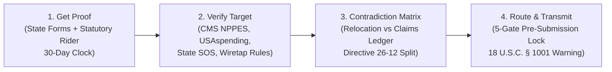

# JustLegal OS

> **A Free, Private, Local-First Legal Operating System & Document Compiler**  
> Developed by **Just Liberty Incorporated**, a Colorado 501(c)(3) Nonprofit Organization.  
> **Official Portals & Socials:** [truejust.org](https://www.truejust.org) • [justlegal.me](https://justlegal.me) • [Fraud Triage](https://justlegal.me/qui-tam) • [LinkedIn](https://www.linkedin.com/company/just-liberty-incorporated/)  
> **Direct Contact:** [josh@truejust.org](mailto:josh@truejust.org)  
> Powered by the **OpenSeason** pure-Rust formatting core and Executive Order 14395 False Claims Act triage engine.

[](file:///src-tauri)
[](file:///src)
[](https://www.linkedin.com/company/just-liberty-incorporated/)
[](LICENSE)
[-success)](docs/SYNC-AND-CLOUD.md)
[](docs/QUI-TAM-EO14395.md)

---

## Executive Overview

**JustLegal OS** is a free, privacy-first legal self-help platform and deterministic procedural operating system designed to dramatically reduce the procedural barriers faced by self-represented litigants, legal aid clinics, and pro bono attorneys.

The central problem JustLegal addresses is the enormous procedural burden placed on people navigating civil courts, administrative agencies, or whistleblower disclosures without full legal representation. Courts strictly enforce caption styles, deadline math, evidentiary separation, certificate of service requirements, and sworn declaration oaths. Missing a single statutory requirement or hedging an affidavit can trigger summary dismissal.

JustLegal solves this by acting as a **deterministic procedural compiler**: it accepts a person's own drafts, verified court records, and physical evidence, checks them against jurisdiction-specific court rules and statutory deadlines, and outputs publication-grade, court-compliant Word (`.docx`) and 28-line numbered PDF packages.

### Legal Guardrails & Mission

* **Not a Law Firm:** JustLegal is developed by a 501(c)(3) nonprofit and does not practice law, give legal advice, invent facts, hallucinate citations, or file/serve documents.
* **Pro-Se Empowerment & Professional Referrals:** Every export reminds users to review every line and consult a licensed attorney. JustLegal directly connects users with state bar association referral services, legal aid organizations, and affordable limited-scope representation under ABA Model Rule 5.4.
* **100% Airgapped Confidentiality:** Sealed matters and whistleblower dossiers are permanently isolated from the internet with zero telemetry, client-side encryption (XChaCha20Poly1305 + Argon2id), and hard filesystem locks.

---

## The 3-Part JustLegal Ecosystem


| Component | Platform / Tech | Purpose & Core Capabilities | Development Status |
|---|---|---|---|
| **[JustLegal.me](https://justlegal.me)** | React, TypeScript, Vite, Firebase | **Public Legal Resource Hub:** 22,936 court forms, 16,023 mirrored PDFs, in-browser PDF tools, legal aid directories, fee waiver guides, and optional authenticated case sync. | Existing operational website; UX and deep-linking upgrades active. |
| **JustLegal OS Desktop** | Tauri v2, Svelte 5, Rust (`open_season_lib`) | **Local-First Legal Operating System:** Offline case dossiers, multi-tier matter management, 1-click Bates stamping, court record reconstruction, ADA Title II petitions, and zero-telemetry vault. | Pre-compiled standalone `.exe`, `.msi`, and source builds ready. |
| **JustLegal Assistant / GrokBot** | Single Public Recipe, 11 Modular Skills, CLI Bridge | **Conversational Guide & Agent Operator:** Unified public conversational triage for civil procedure and fraud intake; 11 on-disk modular skills with fail-closed verification receipts. | Unified `grok_recipe.json` and 11 modular skills ready in `MCP_Grok/`. |

---

## National Court Forms Registry & Public Tools

The public **[JustLegal.me](https://justlegal.me)** platform hosts one of the largest structured legal self-help catalogs in the United States:

* **22,936 Indexed Court Forms:** Covering all 50 states, Washington D.C., and all 94 federal judicial districts.
* **16,023 Mirrored Official PDFs:** Stored with retrieval metadata, official source links, and SHA-256 integrity verification hashes.
* **In-Browser Legal Utilities:**
  - **PDF Studio & Zero-Leakage PII Redactor:** Merge, split, rotate, and scrub SSNs/DOBs client-side.
  - **Bates Stamper:** Sequentially number exhibits with custom prefix formatting (e.g., `ABRAMS-000001`).
  - **Fee Waiver Generator:** Guided completion of in forma pauperis financial qualification forms.
  - **Courtroom Oral Argument Cards:** Structured rehearsal notes and hearing outline cards.
  - **State Bar & Legal Aid Router:** Direct referral to State Bar certified lawyer referral services and Legal Services Corporation (LSC) providers.

---

## 23 Production Subsystems & 120 Deterministic Tools (Pure-Rust Engine & CLI)

The deterministic Rust core (`src-tauri/src/`) and native command-line interface (**`JustLegalOS-CLI.exe`**) expose 18 modular subsystems across 111 commands that both human operators and autonomous AI agents can operate with mathematical reproducibility:

```
┌────────────────────────────────────────────────────────────────────────┐
│               JUSTLEGAL OS SUB-SYSTEM ARCHITECTURE MATRIX              │
├───────────────────────────────────┬────────────────────────────────────┤
│ 1. 360° Case Context Bundle       │ 10. Bates Packets & Court Exports  │
│    • `case context` (1-call JSON) │    • `export exhibit-packet`       │
│    • Profile, events, gaps, rules │    • Typst 28-line numbered PDFs   │
├───────────────────────────────────┼────────────────────────────────────┤
│ 2. Guided Intake & PDF Auto-Scan  │ 11. Zero-Leakage Offline PDF Studio│
│    • `intake scan` & `answer`     │    • `pdf merge|split|rotate|redact`│
│    • Offline PDF text extraction  │    • Byte-level PII scrubbing      │
├───────────────────────────────────┼────────────────────────────────────┤
│ 3. Predictive Next Steps & Venue  │ 12. EO 14395 Qui Tam Fraud Triage  │
│    • `case next-steps`            │    • `qui-tam verify|audit-9b|pack`│
│    • NJ Pause vs. Fed Reset toll  │    • Dual-track routing & card     │
├───────────────────────────────────┼────────────────────────────────────┤
│ 4. 30-Day Extension Safeguard     │ 13. Sovereign Immunity Audit       │
│    • `motion new --kind enlarge`  │    • `sovereign-immunity`          │
│    • Procedural lifeline & email  │    • Ex parte Young, ADA § 504     │
├───────────────────────────────────┼────────────────────────────────────┤
│ 5. Court Record Reconstruction    │ 14. Vernacular-to-Doctrine Engine  │
│    • `record inventory|reconcile` │    • `claim translate`             │
│    • Docket text parser & Form NJ │    • Mountain of proof (X + Y + Z) │
├───────────────────────────────────┼────────────────────────────────────┤
│ 6. Judicial Findings Audit        │ 15. Pro Se Multi-Plaintiff Joinder │
│    • `review record`              │    • `collective-action`           │
│    • Cross-examines orders vs doc │    • FRCP Rule 20(a)(1) force mult.│
├───────────────────────────────────┼────────────────────────────────────┤
│ 7. Accountability & Ethics Packets│ 16. Statutory Open Records Suite   │
│    • `accountability routes|packet│    • `records find|draft|track`    │
│    • Judicial & attorney ethics   │    • CORA, FOIA, 501(c)(3) waivers │
├───────────────────────────────────┼────────────────────────────────────┤
│ 8. ADA Title II Petition Engine   │ 17. 14-Pathway Accountability Map  │
│    • `ada petition`               │    • `accountability map`          │
│    • CART, remote hearing, breaks │    • Systemic & contractor routes  │
├───────────────────────────────────┼────────────────────────────────────┤
│ 9. Proof of Service & Orders      │ 18. Receiver-Ready Formatter       │
│    • `service cert` & `order`     │    • `export receiver`             │
│    • Judge-ready Proposed Orders  │    • DOL-OIG, CO-OSA, GAO FraudNet │
├───────────────────────────────────┼────────────────────────────────────┤
│ 19. 50-State Jurisdiction Engine  │ 20. DOJ WHIP Verification & Gaps   │
│    • `jurisdiction status|lock`   │    • `whip receipt|gaps|route-hold`│
│    • 5-slot traffic light receipt │    • `packet lint` pre-export check│
├───────────────────────────────────┼────────────────────────────────────┤
│ 21. Unified GrokBot Workspace     │ 22. Investigation Traps & Consent  │
│    • `init-workspace`             │    • `check state-traps`           │
│    • Embeds skills, bin, cases    │    • 1-party vs 2-party wiretap laws│
└───────────────────────────────────┴────────────────────────────────────┘
```

### CLI Command Family Quick-Reference

All commands output structured, envelope-wrapped JSON (`{ ok, never_files, never_serves, data, issues }`):

```bash
# 1. Inspect complete case context in a single call
.\JustLegalOS-CLI.exe --json case context Documents/JustLegal/Cases/lucille-abrams

# 2. Extract offline text and candidate dates from court PDFs
.\JustLegalOS-CLI.exe --json intake scan Documents/JustLegal/Cases/lucille-abrams

# 3. Compute predictive next procedural steps and deadline tolling
.\JustLegalOS-CLI.exe --json case next-steps Documents/JustLegal/Cases/lucille-abrams
.\JustLegalOS-CLI.exe --json check venue Documents/JustLegal/Cases/lucille-abrams

# 4. Court Record Reconstruction & Transcript Reconciliation
.\JustLegalOS-CLI.exe --json record inventory Documents/JustLegal/Cases/lucille-abrams
.\JustLegalOS-CLI.exe --json record reconcile Documents/JustLegal/Cases/lucille-abrams --docket "02/15/2026 ORDER DISMISSING COMPLAINT..."
.\JustLegalOS-CLI.exe --json record missing Documents/JustLegal/Cases/lucille-abrams
.\JustLegalOS-CLI.exe --json record request-form Documents/JustLegal/Cases/lucille-abrams --state NJ

# 5. Judicial Findings Audit & Ethical Accountability
.\JustLegalOS-CLI.exe --json review record Documents/JustLegal/Cases/lucille-abrams
.\JustLegalOS-CLI.exe --json accountability routes Documents/JustLegal/Cases/lucille-abrams
.\JustLegalOS-CLI.exe --json accountability packet Documents/JustLegal/Cases/lucille-abrams --issue "finding-3-unsupported"

# 6. ADA Title II Accommodation Petition Generator
.\JustLegalOS-CLI.exe --json ada petition Documents/JustLegal/Cases/lucille-abrams --name "Jordan Example" --accommodations "remote,reading_time"

# 7. False Claims Act / Qui Tam Fraud Triage (EO 14395)
.\JustLegalOS-CLI.exe --json qui-tam verify-entity --name "Jordan Health LLC" --state MN
.\JustLegalOS-CLI.exe --json qui-tam audit-9b Documents/JustLegal/Cases/lucille-abrams
.\JustLegalOS-CLI.exe --json qui-tam ingest-observation Documents/JustLegal/Cases/lucille-abrams --file "photo.jpg" --notes "Doors locked at 2 PM on Tuesday"
.\JustLegalOS-CLI.exe --json qui-tam records-pack Documents/JustLegal/Cases/lucille-abrams --state MN
.\JustLegalOS-CLI.exe --json qui-tam export-disclosure Documents/JustLegal/Cases/lucille-abrams
.\JustLegalOS-CLI.exe --json qui-tam format-inquiry Documents/JustLegal/Cases/lucille-abrams
.\JustLegalOS-CLI.exe --json qui-tam format-portal Documents/JustLegal/Cases/lucille-abrams --agency HHS

# 8. DOJ Whistleblower Incentive Program (WHIP) & Fail-Closed Audits
.\JustLegalOS-CLI.exe --json whip receipt Documents/JustLegal/Cases/lucille-abrams
.\JustLegalOS-CLI.exe --json whip gaps Documents/JustLegal/Cases/lucille-abrams
.\JustLegalOS-CLI.exe --json whip route-hold Documents/JustLegal/Cases/lucille-abrams
.\JustLegalOS-CLI.exe --json whip conflict-roster Documents/JustLegal/Cases/lucille-abrams
.\JustLegalOS-CLI.exe --json whip compare-routes Documents/JustLegal/Cases/lucille-abrams
.\JustLegalOS-CLI.exe --json whip prepare Documents/JustLegal/Cases/lucille-abrams
.\JustLegalOS-CLI.exe --json whip quick-pack --name "Target Clinic LLC" --file "photo.jpg" --notes "Doors locked at 2 PM on Tuesday"
.\JustLegalOS-CLI.exe --json packet lint Documents/JustLegal/Cases/lucille-abrams

# 9. Vernacular-to-Doctrine Translator & Mountain-of-Proof Blueprint (P17)
.\JustLegalOS-CLI.exe --json claim translate --vernacular "The governor and director committed treason and kickbacks by letting Deloitte break the unemployment computer"

# 9. Sovereign Immunity Audit & Valid Bypass Pathways (P18)
.\JustLegalOS-CLI.exe --json sovereign-immunity --state CO --target gov-agency --claim "FCA qui tam" --claim "ADA Title II disability" --claim "Ex parte Young due process"

# 10. Collective Action Builder (Rule 20 Permissive Joinder / Pro Se Force Multiplier) (P19)
.\JustLegalOS-CLI.exe --json collective-action --mode rule20-joinder --title "CDLE Automated Hold Challenge" --defendant "CDLE & Deloitte"

# 11. Statutory Open Records Pre-Filing Discovery Suite (CORA, FOIA, NC DES, § 603.5(d)) (P2–P8)
.\JustLegalOS-CLI.exe --json records find --jurisdiction CO --type contract
.\JustLegalOS-CLI.exe --json records draft Documents/JustLegal/Cases/lucille-abrams --jurisdiction CO --type contract --fee-waiver
.\JustLegalOS-CLI.exe --json records track Documents/JustLegal/Cases/lucille-abrams --id CORA-01 --agency "CDLE Custodian" --sent 2026-03-01 --days 3
.\JustLegalOS-CLI.exe --json records followup Documents/JustLegal/Cases/lucille-abrams --id CORA-01 --agency "CDLE Custodian" --kind late
.\JustLegalOS-CLI.exe --json records org

# 12. 14-Pathway Systematic Accountability Map (P1)
.\JustLegalOS-CLI.exe --json accountability map Documents/JustLegal/Cases/lucille-abrams --state CO --program UI --target-type state-agency

# 13. 50-State Jurisdiction Verification & Primary-Source Rule Pinning
.\JustLegalOS-CLI.exe --json jurisdiction status Documents/JustLegal/Cases/lucille-abrams
.\JustLegalOS-CLI.exe --json jurisdiction lock-rule Documents/JustLegal/Cases/lucille-abrams --slot local_court_rules --cite "Middlesex Vicinage SO 24-02" --url "https://www.njcourts.gov/middlesex"
.\JustLegalOS-CLI.exe --json check state-traps --state CA

# 14. 4-State Verification Receipt & Refusal over Grade
.\JustLegalOS-CLI.exe --json whip receipt Documents/JustLegal/Cases/lucille-abrams

# 15. Shared Agent Workspace Initialization
.\JustLegalOS-CLI.exe --json init-workspace --root /workspace

# 13. Receiver-Ready Formatter (P16)
.\JustLegalOS-CLI.exe --json export receiver Documents/JustLegal/Cases/lucille-abrams --to dol-oig

# 14. Document Production, Bates Stamping & Redaction
.\JustLegalOS-CLI.exe --json export exhibit-packet Documents/JustLegal/Cases/lucille-abrams --prefix "ABRAMS-"
.\JustLegalOS-CLI.exe --json export court-md Documents/JustLegal/Cases/lucille-abrams
.\JustLegalOS-CLI.exe --json pdf redact --input "sensitive.pdf" --patterns "SSN,DOB"
```

---

## Dual-Track Whistleblower Verification: DOJ WHIP & Sealed Qui Tam (EO 14395)

Built specifically to operationalize the White House / DOJ **Fraud Whistleblower Incentive Program (WHIP on fraud.gov)**, the **DOJ May 27, 2026 Benefits-Fraud Directive**, and **False Claims Act** (*31 U.S.C. §§ 3729–3733*) triage:

1. **Tier 1: Fast-Track Citizen Bounty (`WHIP` via `fraud.gov`):** Administrative bounty track for street-level observations. Generates character-limited (≤1,950 character) submissions, scrubs personal identifying information, strips EXIF GPS coordinates, and compiles a tamper-proof photographic PDF packet with full 64-character SHA-256 digests.
2. **Track 2: Sealed Qui Tam Lawsuit (31 U.S.C. §§ 3729–3733 — 15% to 30% Relator Share):** For contractor and institutional schemes (e.g., IT contracts, regional healthcare billing). Evaluates statutory intervention windows without premature public disclosure.
3. **Insider Gatekeeper Fork (`whip route-hold`):** Non-public insider records held by the relator trigger an automatic lock blocking public portal export (`portal_export_blocked = true`). The system instead exports a factual index and a conflict-check roster (names and identifiers only, zero narrative) for retained counsel.
4. **Fail-Closed 4-State Verification Receipt (`whip receipt` & `whip gaps`):** Replaces artificial score gauges with an unembellished 4-state table (`VERIFIED`, `USER_STATED`, `MISSING`, `LOOKUP_FAILED`). Exits with code 1 on blocking gaps before allowing export.
5. **Pre-Export Audit Linter (`packet lint`):** Scans all generated export files and fails closed if any forbidden vanity phrases, unsworn certifications, or invented legal conclusions are detected.
6. **Factual Calling Card:** Injects a clean, factual header with the public verification URL (`https://justlegal.me/qui-tam`) without asserting unverified legal conclusions.

---

## The Master 4-Step Funnel Across All Surfaces

JustLegal OS, the Desktop GUI, the CLI, and GrokBot guide citizens and investigators through a deterministic 4-step sequence powered by a single normalized dataset:



1. **Step 1: Get Your Proof (First-Party Statutory Discovery & 30-Day Countdown):**
   - Direct statutory requests for Medicaid claims histories (**45 C.F.R. § 164.524**), Unemployment claim files (**20 C.F.R. § 603.5(c)**), SNAP casefiles (**7 C.F.R. § 273.15(p)**), and state vendor contracts (**CORA/OPRA/FOIA**).
   - Solves the mailroom vs. backend database dilemma with the **"Official State Form + Itemized Statutory Rider"** pattern.
   - Enforces the **Stage 1 vs. Stage 4 Firewall**: personal records requests are strictly quarantined from fraud prosecution hotlines.
2. **Step 2: Verify Your Target (Objective Cross-Registry Corroboration):**
   - Verifies rendering and billing entities against CMS NPPES v2.1 (10-digit NPIs), USAspending federal obligations, state corporate registries, and state licensing boards.
   - Audits state-specific recording rules (one-party vs. all-party wiretap laws) before evidentiary audio is logged.
3. **Step 3: Build the Contradiction Matrix (Relocation vs. Claims Auditing):**
   - Ingests claims ledgers (`.pdf`, `.csv`, `.tsv`, `.json`) and cross-references transaction dates against documented absence/relocation dates.
   - Partitions multi-provider ledgers into discrete dossiers pursuant to **DOJ Directive 26-12** to prevent multi-defendant dismissals.
4. **Step 4: Route & Transmit (The 5-Gate Pre-Submission Protocol):**
   - Evaluates the Insider vs. Outsider fork: non-public insider records route exclusively to sealed relator counsel under ABA Model Rule 1.18.
   - External disclosures for `america.gov/fraud` or agency OIGs proceed only after all 5 Pre-Submission Gates pass and the human explicitly authorizes transmission.

---

## The 5-Gate Pre-Submission Lock (Zero Autonomous Filing)

To prevent premature submissions, safeguard statutory standing, and protect against automated overreach, JustLegal OS and GrokBot enforce a mandatory 5-gate protocol:

| Gate | Verification Check | Failure Action |
|---|---|---|
| **Gate 1: Verification Receipt** | Target credentials verified on CMS NPPES & USAspending; data partitioned into `VERIFIED` vs. `USER_STATED`. | Blocks submission until entity credentials resolve. |
| **Gate 2: Lawful Evidence & Privacy** | Audio evidence complies with state wiretap laws; third-party PII scrubbed; photographic EXIF GPS tags stripped. | Blocks submission until evidence is legally grounded. |
| **Gate 3: Insider & Route Clearance** | If user holds non-public insider records, public web portal export is locked (`portal_export_blocked = true`). | Routes user to zero-narrative conflict roster for sealed counsel. |
| **Gate 4: Pre-Export Packet Linter** | Narrative $\le 1,950$ characters; 64-char SHA-256 hashes verified; 0 banned vanity or inflammatory phrases. | Fails closed (exit code 1) until text is compliant. |
| **Gate 5: Explicit Human Review ("GO")** | Renders exact form fields in chat/browser; displays statutory warning; awaits user's affirmative confirmation. | Halts execution. Never auto-submits without explicit consent. |

---

## 50-State Legal Discovery & The 6 Operational Pillars

State public records and beneficiary access rules vary widely. JustLegal OS compiles these rules into **`data/states_50.json`** across 51 jurisdictions (50 States + D.C.) under 6 operational pillars:

1. **Anti-Rejection Form Rules (Stage 1):** Provides the official mandatory state agency form number and URL, while generating the **"Cover Demand + Itemized Statutory Rider"** to legally compel backend MMIS codes, 10-digit NPIs, and monthly MCO capitation ledgers.
2. **Public Registry Lookup Engines (Stage 2):** Direct deep-search URLs for state spending checkbooks, corporate business registries, day care licensing portals, and health facility verification.
3. **State Litigation Traps & Wiretap Laws:** State-specific response deadlines, exhaustion rules, notice-of-claim deadlines, and audio recording consent classifications (one-party vs. all-party).
4. **Contradiction & Splitting Playbook (Stage 3):** Step-by-step methodology for isolating billing impossibility across dates of service.
5. **Enforcement Receivers (Stage 4):** Authoritative contacts for State Medicaid Fraud Control Units (MFCUs), State Auditor hotlines, and federal whistleblower coordinators.
6. **Statutory Anti-Abuse Shield (18 U.S.C. § 1001):** Submitting false or fictitious statements to government bodies is a federal crime. JustLegal OS enforces strictly objective, non-speculative documentation.

---

## Technical Specifications & Verification Gates

* **Desktop Application:** Tauri v2, Svelte 5, TypeScript, Tailwind CSS, Vite (`JustLegalOS.exe`).
* **Command-Line & MCP Server:** Rust native binary (`JustLegalOS-CLI.exe`), clap 4.5, stdio JSON-RPC 2.0.
* **Document Compilation:** Typst 0.12 (native PDF typesetting), Office Open XML (Word DOCX), `lopdf` (offline stream parsing).
* **Cryptography & Vault:** XChaCha20Poly1305, Argon2id password verifier, SHA-256/SHA-512 Merkle provenance, strict filesystem permissions.
* **Verification Gates (Passing):**
  - **178 Rust tests passing** (`cargo test --manifest-path src-tauri/Cargo.toml`).
  - **0 Svelte / TypeScript errors** (`npm run check`).
  - **Deterministic zero-telemetry guarantee:** Tested in `src-tauri/src/sync.rs` and `seal.rs`.

---

## Getting Started

### Ready-to-Run Standalone Binaries & Installers
* **Desktop Application:** Run `.\JustLegalOS.exe` in the root repository.
* **Agent CLI & MCP Server:** Run `.\JustLegalOS-CLI.exe` in the root repository.
* **Production Installers:**
  - `installers/JustLegalOS_0.1.0_x64-setup.exe` (Windows NSIS Setup Installer)
  - `installers/JustLegalOS_0.1.0_x64_en-US.msi` (Windows WiX MSI Enterprise Installer)
  - macOS `.dmg` installers (`aarch64` Apple Silicon & `x86_64` Intel) are built on native macOS runners via the automated GitHub Actions pipeline in `.github/workflows/release.yml`.

### Building from Source

```bash
# Clone the repository
git clone https://github.com/unlimitedinfinit/JustLegalOS.git
cd JustLegalOS

# Install frontend dependencies
npm install --legacy-peer-deps

# Run test suite
cargo test --manifest-path src-tauri/Cargo.toml
npm run check

# Launch development environment (Vite + Tauri)
npm run tauri dev

# Compile standalone production binaries
npm run tauri build -- --no-bundle
```

---

## Project Repository Layout

```
JustLegal/
├── JustLegalOS.exe           # Standalone Desktop GUI (Tauri v2 + Svelte 5)
├── JustLegalOS-CLI.exe       # Headless Agent CLI & Stdio MCP Server (Rust)
├── launch.bat / launch.ps1   # 1-Click Interactive Desktop Launchers
├── src/                      # Svelte 5 Frontend (Dashboard, Wizards, Cards)
│   ├── routes/               # Case views, dockets, and home screens
│   └── lib/components/       # 3-Tier launchpad, audit cards, modals
├── src-tauri/                # Core Rust Engine (46+ Modular Crate Files)
│   ├── src/qui_tam/          # EO 14395 triage, Rule 9(b), NPPES, dual-track
│   ├── src/accountability/   # Judicial review, ethics routes, discrepancy packets
│   ├── src/court_access/     # Title II ADA petition generator & accommodations
│   ├── src/record/           # Evidentiary tiers, docket reconciliation & FOIA
│   ├── src/documents/        # Typst PDF and Word DOCX court document compilers
│   ├── src/mcp/              # Native Stdio JSON-RPC 2.0 MCP server tools
│   └── src/bin/justlegalos/   # Modular JustLegalOS-CLI command handlers
├── MCP_Grok/                 # GrokBot Blueprints, System Prompts & Skill Files
├── templates/                # Jurisdiction Rule Packs (NJ, CO, Federal, SCOTUS)
├── fixtures/                 # Obviously fake sample cases (Jordan Example)
└── docs/                     # Full Architectural & Procedural Documentation
```

---

## Ethical Boundaries & Disclaimers

**JustLegal OS is a formatting and assembly aid, not a law firm.**  
It does not practice law, file papers, serve process, or give legal advice. Users are solely responsible for reviewing every page before filing and ensuring accuracy under court rules. Confidential cases are never uploaded to the cloud.

* **Terms of Service:** [https://justlegal.me/terms](https://justlegal.me/terms)
* **Privacy Policy:** [https://justlegal.me/privacy](https://justlegal.me/privacy)
* **Legal Aid & Bar Referral Hub:** [https://justlegal.me/find-legal-help](https://justlegal.me/find-legal-help)
* **LinkedIn:** [https://www.linkedin.com/company/just-liberty-incorporated/](https://www.linkedin.com/company/just-liberty-incorporated/)
* **Contact:** [josh@truejust.org](mailto:josh@truejust.org)

Developed with care by **Just Liberty Incorporated** (Colorado 501(c)(3)) to make the rule of law accessible to everyone.
